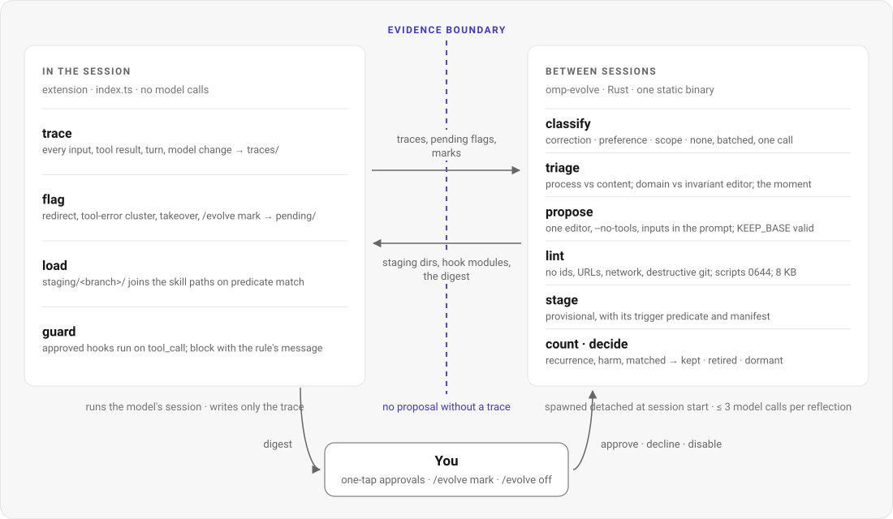
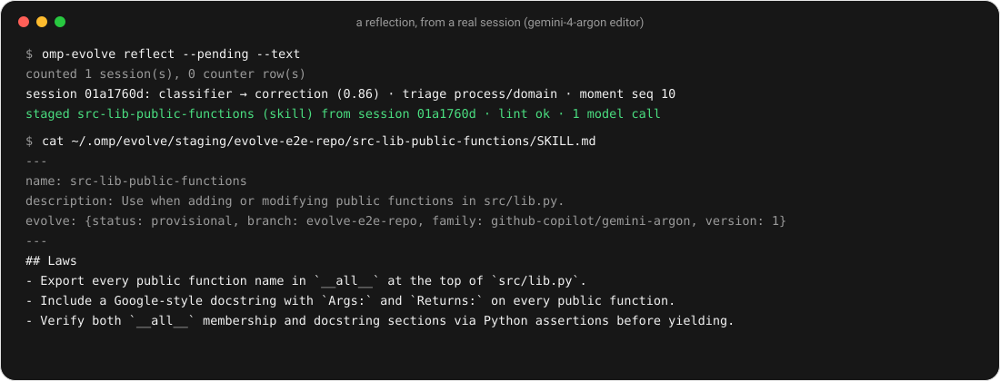
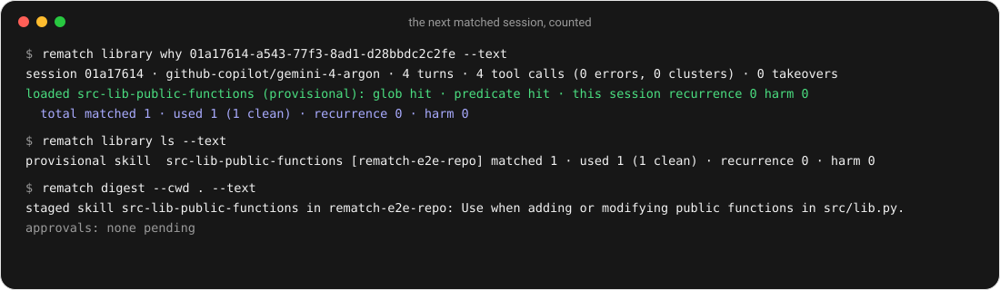
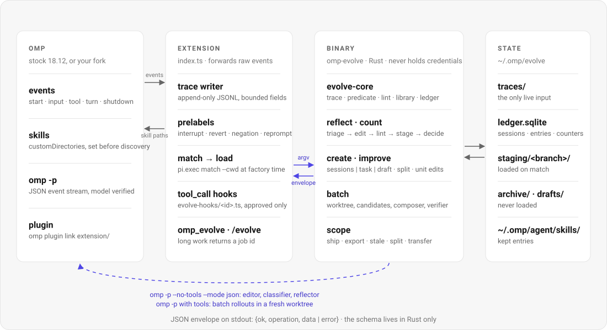

<p align="center">
  <picture>
    <source media="(prefers-color-scheme: dark)" srcset="docs/assets/readme/wordmark-dark.svg">
    
  </picture>
</p>

<p align="center"><b>Let the agent improve its own harness from the sessions you were going to run anyway, and keep only what later sessions confirm.</b></p>

<p align="center">
  <a href="#what-you-can-do-with-it">What you can do with it</a> ·
  <a href="#thirty-second-start">Start</a> ·
  <a href="#how-it-works">How it works</a> ·
  <a href="#in-one-minute">In one minute</a> ·
  <a href="#how-a-reflection-works">How a reflection works</a> ·
  <a href="#what-it-counts">Counters</a> ·
  <a href="#architecture">Architecture</a> ·
  <a href="docs/DESIGN.md">Design</a>
</p>

<p align="center">
  
  
  
  <a href="#license"></a>
</p>

## What you can do with it

- **Do nothing.** Work in omp as usual. Every session is traced. A session that ended with a redirect, a tool-error cluster, or a takeover produces one bounded proposal at the start of the next session, staged as `provisional`. Later sessions that match load it. Counters decide whether it stays.
- **Create a skill.** `/rematch create <name> --from sessions|task`. From three matching sessions, or from one reference run of a task you name. A description with neither becomes a `draft` that never loads until you activate it.
- **Improve a skill from history.** `/rematch improve <skill>`. Registers it, audits where it loaded, clusters the redirects and errors that happened with it in context, proposes unit-level edits, stages the new version beside the old one. Refuses with a count if fewer than five traced sessions used it, and offers the mechanical split instead.
- **Run a batch job with a verifier.** `/rematch run --task <id> --verifier <cmd>`. Reference rollout, two candidates, probe, compose, re-run; the verifier picks. Never a model's opinion of its own output.
- **See why.** `/rematch why`, `/rematch status`, `/rematch library`. Which entries were loaded for the last deliverable, what was staged, kept, retired, and the raw counts per entry.
- **Correct it or stop it.** `/rematch mark correction|preference|scope` overrides the classifier for the last turn. `/rematch off`, `REMATCH=0`, `/rematch disable <id>`, `/rematch rollback <skill>`, `rematch uninstall` are immediate.

## Thirty-second start

From a checkout of this repo, with omp 18.12 and a Rust toolchain:

```sh
scripts/install.sh            # cargo build --release · omp plugin link extension/ · ~/.local/bin/rematch
rematch import --history      # seed the ledger from your existing omp sessions (read-only)
rematch doctor --text         # omp version, resolved editor/classifier roles, extension linked, ledger schema
```

Then use omp. The first proposal arrives after the first session that ends with a redirect.

Optional, in `~/.omp/agent/config.yml`: `modelRoles.rematch-editor` for the strongest model you have and `modelRoles.rematch-classifier` for a fast one. Without them the editor falls back to `slow` → `default`, the classifier to `smol` → `tiny` → `default`.

## How it works

The session is the evidence. The extension writes every input, tool result and turn to a trace file of its own, and at shutdown flags the session only if it carried a signal: a redirect, a cluster of tool errors, a takeover, or an explicit mark. Nothing runs inside the session. At the start of the next session the binary is spawned detached: it classifies the redirect, finds the moment, runs one editor with the trace excerpt in the prompt, lints the result, and stages it as a `provisional` entry with a deterministic trigger predicate. Sessions whose predicate matches load it from the staging path. For each matched session the binary counts whether the specific redirect class that motivated the entry recurred, and whether harm occurred. Keep at zero recurrences over at least four matched sessions; retire at two recurrences or two harm events; dormant after twelve without a decision.

---

<p align="center"><b>A harness-improvement loop that costs no reruns in interactive use. The real session is the reference rollout, the next matched session is the probe, and a reflection costs at most three model calls.</b></p>

rematch is an omp plugin: a TypeScript extension that omp loads, and a Rust binary the extension calls with a JSON envelope. The extension only records and toggles; the binary proposes and stages. Skill text activates in personal scope on its own. Anything executable (scripts, hooks) and anything beyond personal scope (team `.omp/`, your fork) waits for a one-tap approval or a merged PR. No fork of omp is required; the fork is one of the things it can propose changes to.

<p align="center">
  <picture>
    <source media="(prefers-color-scheme: dark)" srcset="docs/assets/readme/loop-dark.svg">
    
  </picture>
</p>

## Contents

- [What you can do with it](#what-you-can-do-with-it)
- [Thirty-second start](#thirty-second-start)
- [How it works](#how-it-works)
- [In one minute](#in-one-minute)
- [Highlights](#highlights)
- [How a reflection works](#how-a-reflection-works)
- [What it counts](#what-it-counts)
- [Statuses](#statuses)
- [Create and improve](#create-and-improve)
- [Batch mode](#batch-mode)
- [Scope and who merges](#scope-and-who-merges)
- [Models](#models)
- [How it compares](#how-it-compares)
- [Architecture](#architecture)
- [Run it](#run-it)
- [Status](#status)
- [Docs](#docs)
- [License](#license)

## In one minute

1. **Work.** You ask for a function in `src/lib.py`. The agent adds it. You answer: *"That's wrong. Every public function here needs a Google-style docstring and must be exported in `__all__`."* The extension pre-labels the turn as a negation and flags the session at shutdown.
2. **Reflect.** Next session start, the binary classifies the redirect (`correction`, 0.86), triages it as a process failure about this workload's conventions, and runs the domain editor once with the trace excerpt. The reply passes lint and is staged with a predicate: this repo, `.py` files, the stems of the task turn.
3. **Keep or retire.** The next session that adds a function to `src/lib.py` loads the entry. The agent exports and documents the function unprompted. The session counts as `matched 1 · recurrence 0 · harm 0`. Three more like it and the entry is `kept`; two redirects of the same class and it is retired.

<p align="center">
  <picture>
    <source media="(prefers-color-scheme: dark)" srcset="docs/assets/readme/reflect-dark.svg">
    
  </picture>
</p>
<p align="center"><em>A reflection from a real session on a scratch repository, with gemini-4-argon as classifier and editor. Output condensed to the lines that matter.</em></p>

<p align="center">
  <picture>
    <source media="(prefers-color-scheme: dark)" srcset="docs/assets/readme/why-dark.svg">
    
  </picture>
</p>
<p align="center"><em>The next matched session. <code>why</code> explains the load and the count; <code>ls</code> shows the counts raw.</em></p>

## Highlights

- **No proposal without a trace.** Every entry cites the moment (`session_id`, `seq`) it came from. A description-only skill is a `draft` that never loads until you run a task with it or accept it unverified.
- **No reruns in interactive use.** The real session is the reference and the next matched session is the probe. A reflection spends at most three model calls: one batched classifier call, one editor, one lint retry.
- **Kept by use, retired by counters.** The primary signal is recurrence of the specific redirect class that motivated the entry, not tokens, not turns, not a judge. Counts are raw and shown raw. The status is called `kept`, never `verified`.
- **Nothing executable without you.** Scripts are staged mode 0644. Hooks are compiled only after approval. Both arrive as one-tap approvals in the session-start digest, with the diff.
- **Lint is static and free.** No session ids, task paths or user names in the text; no string-match on the user's words; a trigger predicate and a trigger line on every entry; no URLs, network calls or destructive git; always-on text within 8 KB per branch; facts carry `as_of`.
- **A bad entry cannot cascade.** One admission per trigger predicate per day, ten provisional entries per branch, no new reflection while a canary for the same trigger is pending.
- **The schema lives in Rust only.** The extension forwards raw events and parses nothing. One static binary owns the ledger, the library, lint, staging, batch mode, PR output. It never holds provider credentials; model calls go through `omp -p` and every event's provider and model are verified.
- **Rollback and uninstall.** Every kept entry keeps its predecessor. `uninstall` removes every file the plugin wrote and nothing else.

## How a reflection works

| Step | What happens | Enforced by |
|---|---|---|
| **Flag** | At shutdown the extension flags the session only if it carried a signal: a pre-labelled redirect (`interrupt`, `revert`, `negation`, `reprompt`), three tool errors in any six consecutive results, or `/rematch mark`. Clean sessions produce nothing. | extension; a 2-second budget, so it writes one small file |
| **Classify** | One batched call labels each redirect `correction`, `preference`, `scope` or `none`. A session whose only redirects are `scope` or `none` carries no signal and gets no editor call. A mark overrides the classifier and is never overridden. | binary (`reflect.rs`) |
| **Triage** | The first failure is either *process* (anything the agent produced with tools, tool-error clusters, takeovers, reverts, procedural text) or *content* (a corrected prose answer). Content failures are logged, not proposed on. Separately, the scope picks the editor: *domain* by default, *invariant* when the failure is about the agent's general way of working. | `trace::triage` |
| **Predicate** | Repo path, the extensions of files touched in the evidence window, and up to ten stems ranked by tf-idf over the task turn, the touched files and the redirect. The hash of this predicate keys the rate limits. | `predicate::derive` |
| **Propose** | One editor session through `omp -p --no-tools`, inputs in the prompt: the trace excerpt, the deliverable, the redirect, the current entry if any, matching `EXPERIENCE.md` lessons. The prompt treats the trace as data. The editor returns edits plus a manifest (evidence moment, predicted fix, predicted regression). `KEEP_BASE` is valid. There is no composer: with no probes, choosing between two untested texts would be blind selection. | `improver/editor.md`; `omp.rs` verifies provider and model on every event |
| **Lint** | Static, free, every rule in `improver/lint.toml`. On an error the editor gets one retry with the findings. | `lint::lint_entry` |
| **Stage** | Written to `staging/<branch>/<name>/` as `provisional` with the predicate, model family, originating session and manifest. Near-duplicates (simhash) route evidence to the existing entry instead. | `library::stage`, `dedup` |
| **Load** | At the next session start the extension asks the binary which staging directories match the working directory and adds them to omp's skill paths before discovery. Every session is an on-session; there is no withheld arm. | extension factory; `library::list_for_match` |
| **Count · decide** | For every finished trace: did the motivating redirect class recur while the entry was loaded; did a tool-error cluster, a takeover or a disable happen. Then the decision rule. After a keep or retire the reflector writes `EXPERIENCE.md` beside the entry; later proposals read matching ones. The editor prompt itself is never amended. | `counters::fold_session`, `counters::decide` |

## What it counts

Each entry carries three raw counters, with a per-family breakdown. Tokens and turns are recorded for `why` and never gated on, because they vary tenfold with task difficulty.

| Counter | Increments when | Decides |
|---|---|---|
| **matched** | the session's repo matched the glob, its file extensions overlapped, and at least two predicate stems appeared in the first five inputs or the files read | the denominator for every decision; dormant at 12 without one |
| **recurrence** | the specific redirect class that motivated the entry happened again while the entry was loaded | retire at 2 |
| **harm** | a new tool-error cluster, a takeover, or a user disable while the entry was loaded | retire at 2 |

Keep at `matched ≥ 4 · recurrence 0 · harm 0`. Four matched sessions with no recurrence is evidence that the entry did its one job, nothing more; that is why the status is `kept`, not `verified`. A model never rewrites counters.

## Statuses

<p align="center">
  <picture>
    <source media="(prefers-color-scheme: dark)" srcset="docs/assets/readme/lifecycle-dark.svg">
    
  </picture>
</p>

| Status | Where it lives | Loaded |
|---|---|---|
| `draft` | `~/.rematch/drafts/<name>/` | never |
| `provisional` | `~/.rematch/staging/<branch>/<name>/` | on predicate match, via the skill paths |
| `kept` | `~/.omp/agent/skills/<name>/`, predecessor in `predecessors/` | natively, every match |
| `stale` · `dormant` · `retired` | `~/.rematch/archive/<status>/<id>/` | never; never deleted |
| `pinned` | wherever it is | a flag; never replaced automatically |

## Create and improve

**Greenfield.** `rematch create <name> --from sessions` searches the ledger (imported history plus traces) for sessions whose features match the request; with three or more, the skill is distilled from what worked and what was redirected. `--from task --task <id>` runs the task once in batch mode (one rollout, no candidates) to obtain a trace; this is the only create that costs a rollout. `--from description` stages a `draft`; `activate <name> --task <id>` or `--unverified` makes it `provisional`. The result is a skill package: a router `SKILL.md` with the trigger line and the checkable laws, `units/` for procedures and pitfalls, `facts/` for measured values with `as_of`, `scripts/` for anything deterministic. Below about 8 KB the package collapses to one file.

**Brownfield.** `rematch improve <skill>` registers the existing skill as a `provisional` entry in place (the file is never moved), audits the sessions that read it and the redirects and errors that happened with it in context, and proposes unit-level edits from the clustered redirects. A skill over 8 KB is split first, mechanically and with no model: router, `units/` by heading, `facts/`, long tables and rejected-hypothesis lists into a ledger-notes unit. The new version is a sibling beside the old one; omp shows the sibling under the bare name and the original under its namespaced name until the counters decide. A `pinned` skill is never replaced.

`rematch import --forge <path>` registers compound-forge's fifteen skills as brownfield entries with predicates from their trigger text, and its `learnings/*.md` as lessons with their evidence hash.

## Batch mode

Where a verifier exists, the plugin spends rollouts the way Harness² does, per task:

1. Reference rollout with the current harness, in a fresh git worktree with a `--config` overlay that exposes only the candidate skill tree.
2. Invariant and domain candidates from the single editor, each probed once on the same task under the same seed.
3. A composer merges from the behavioral contrasts; the composed harness runs once more.
4. The verifier picks among reference, candidates and composed: a test command, a deterministic check script, a parity check against a known result, or a receipt. Ties go to the reference.
5. The winner is kept for that job. Its lessons enter the library as `provisional` with a `pending_next_run` flag; they become `kept` only after the next real run of that job passes with them loaded.

Budget: `rollouts = (k+1)² + [k>1]`, four at `k=1`, ten at `--width 2`; model calls `2k + 1`. `run` returns a job id and runs detached; `status <job>` polls. Workspaces are deleted after the receipt is written.

## Scope and who merges

| Scope | Activation | Examples |
|---|---|---|
| Personal, text | automatic as `provisional` | skill text, laws, facts, lessons |
| Personal, executable or blocking | one tap in the session-start digest, with the diff | scripts (0644 → 0755), compiled `tool_call` verifiers |
| Team (`<repo>/.omp/`) | `ship --scope team`: a branch with the entry and an evidence commit; `--push --pr` opens the PR, never merges | entries whose predicate recurred across two or more repos, or that you list |
| Fork | `ship --scope fork --repo <fork>`: the entry's `fork_path`, the built fingerprint and before/after counters in the PR body | per-model prompt text, tool descriptions, compaction defaults |
| Work → home | `library export`, per-entry approval with the diff; off by default at work (`policy.json`) | invariant entries only; lint with `transfer: true` blocks domain and workspace facts |

A branch is a repo or project. `shared` holds entries kept in two or more branches; promotion needs a second branch's canary and costs nothing. `transfer suggest` lists kept invariant lessons not yet tried in a branch whose facet structure overlaps on two or more keys (`branches/<branch>/domain.yml`); a transfer is applied as `provisional` and earns its place through that branch's counters.

## Models

Every entry records the model family it was created under and keeps a per-family breakdown of its counters. Entries load regardless of family; gating would make them flicker as you switch models. When the counters diverge, harm on one family and clean on another, the entry is split and the harmed family gets its own sibling. A family whose recurrence or harm rises across several entries in one window appears as a review list in the digest, never as automatic retirements. The editor is the strongest configured model; the classifier a fast one; a different provider than configured is a failed run, never a fallback. There is no judge role.

## How it compares

| | Hand-written skills | compound-forge (SkillOpt / GEPA) | rematch |
|---|---|---|---|
| Where evidence comes from | your memory of what went wrong | a benchmark suite you maintain | the execution trace of the session that went wrong |
| Cost per improvement | your time | dozens to hundreds of rollouts | ≤ 3 model calls, 0 reruns (interactive); 4–10 rollouts with a verifier (batch) |
| What decides | you | validation score on held-out cases | recurrence of the motivating redirect over later matched sessions; a verifier in batch mode |
| What can activate on its own | everything you write | nothing (proposals are reviewed) | skill text in personal scope; never scripts, hooks, team or fork changes |
| Exit for a bad change | you notice | regression on the suite | counters retire it; rollback restores the predecessor; `off` stops everything |

**In short:** the loop (scoped editors, lint for generalization, an experience library, composition only where a verifier exists) comes from Harness². What rematch adds is the zero-rerun interactive mode with a deterministic predicate and raw counters, and a boundary that lets the harness propose without being trusted. The cost: a single user is not blinded, so the counters measure only the recurrence of a specific redirect class, something you would not fake; and nothing is ever called verified.

## Architecture

<p align="center">
  <picture>
    <source media="(prefers-color-scheme: dark)" srcset="docs/assets/readme/architecture-dark.svg">
    
  </picture>
</p>

| Unit | What it holds | Rule |
|---|---|---|
| `extension/index.ts` | trace writer, pre-labels, the skill-path override, approved hook modules, the `rematch` tool and `/rematch` command, the digest | forwards raw events; parses nothing; no model calls; every handler fails open except hooks |
| `crates/rematch-core` | trace model and parsers (own trace, omp session JSONL), redirect heuristics and classifier batching, predicates, lint, library and counters, SQLite ledger with content-addressed blobs, package model and mechanical split, simhash dedup, EXPERIENCE.md, rate limits, outcome records | pure functions over paths; no process spawning, no network; 106 unit tests |
| `crates/rematch` | the CLI; `proc.rs` (process-group bounded execution), `omp.rs` (argv builders and per-event provider/model verification), `jobs.rs` (detached jobs), reflect/count, create/improve, import, digest, doctor, uninstall, `batch/`, `scope/` | one JSON envelope per invocation; never holds credentials; 47 unit + 17 end-to-end tests |
| `improver/` | `editor.md`, `reflector.md`, `classifier.md`, `lint.toml`, `omp-no-tools.yml` | copied to `~/.rematch/improver/` on first run; read-only to the system |
| `~/.rematch/` | `traces/`, `pending/`, `ledger.sqlite` + `blobs/`, `staging/<branch>/`, `drafts/`, `archive/`, `predecessors/`, `jobs/`, `runs/`, `tasks/`, `branches/`, `export/`, `off` | one root per environment (`REMATCH_ROOT`); home and work are separate libraries |

The two-language split is kept on one rule: the schema lives in Rust and the extension forwards raw events. The verified omp facts behind every design choice, and the four places the build deviates from the spec because of them (no `resources_discover` callsite in omp, auth living in the agent dir, no registry publish, no embeddings without credentials), are in [`docs/DESIGN.md`](docs/DESIGN.md). The full product spec is [`docs/SPEC.md`](docs/SPEC.md).

## Run it

The checks every change goes through:

```sh
cargo test --workspace                        # 106 core · 47 binary · 17 end-to-end (scripted editors, fake omp)
cargo clippy --workspace --all-targets -- -D warnings
bun build extension/index.ts --no-bundle --outdir /tmp/rematch-ext-check
```

The end-to-end tests run the built binary against a temporary root: a synthetic trace with a redirect is reflected through a scripted editor, staged, matched, counted through four clean sessions and kept into the agent skills dir; the lint-fail script exercises exactly one retry; a wrong-model reply fails closed; `import --history` runs against anonymized goldens; `improve` refuses, splits, stages a sibling and refuses a pinned skill; the batch worker completes a `k=1` cycle with a fake omp and keeps the winner on the next run; `ship` creates the branch and commit; `export` refuses at work by default.

What was run live against omp 18.12.6 before this README was written: the full interactive loop on a scratch repository (rpc-mode sessions with real redirects, gemini-4-argon editor and classifier, the entry loaded in the next session and counted), the forge import and the mechanical split of a 31 KB skill resolved as a package in a live session, one detached batch cycle with a script verifier, one team ship, and `/rematch` in the TUI.

## Status

Built: the interactive loop (Phase 1), create and improve with the mechanical split and the forge import (Phase 1.5), batch mode with worktree isolation and the next-run keep rule (Phase 2), team and fork shipping, work-to-home export, stale on drift, split per family, transfer suggestions and `shared` promotion (Phase 3).

Not yet earned:

- **A `kept` entry from daily use.** The kill criterion in the spec is six weeks of daily use: if no entry reaches `kept` over at least four matched sessions and recurrence has not fallen on any trigger, stop at Phase 1 and keep stock omp with hand-written skills. The trace tooling and `why` stay useful either way.
- **A batch cycle where a candidate beats the reference.** The one live cycle had a reference that already passed, so both editors chose `KEEP_BASE`; the fake-omp tests cover the other branches.
- **A merged team PR and a `shared` promotion from real branches.** Both are exercised on scratch repositories only.
- **Profiles.** `omp --profile <name>` agent directories and `PI_CONFIG_DIR` are not resolved; `PI_CODING_AGENT_DIR` and the default root are.
- **Linux.** The code is POSIX-portable (`setsid`, process groups, `sh` scripts) and every run above was macOS arm64. No Windows.
- **Embeddings for the "related thing" lookup.** Exact signature and MinHash are implemented; embeddings would need credentials the binary does not hold.

Open questions from the spec that the build did not settle are at the end of [`docs/SPEC.md`](docs/SPEC.md#open-questions).

## Docs

[Design contract](docs/DESIGN.md) · [product spec](docs/SPEC.md) · [facet vocabulary (`domain.yml`)](docs/domain.yml.md) · [extension](extension/README.md) · [importer goldens](tests/goldens/README.md)

## License

MIT.
