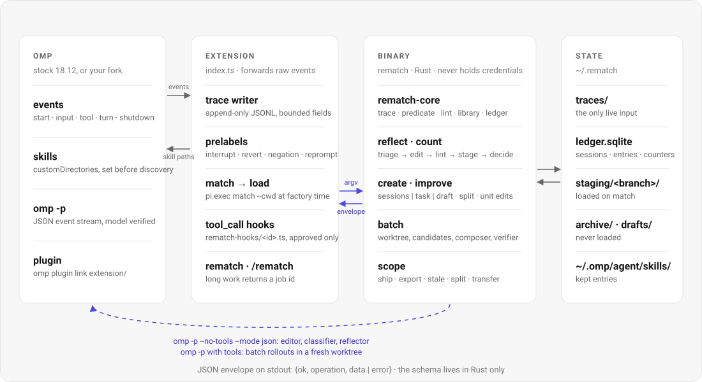

# Architecture

  <picture>
    <source media="(prefers-color-scheme: dark)" srcset="../assets/architecture-dark.svg">
    
  </picture>

| Unit | What it holds | Rule |
|---|---|---|
| `extension/` | `index.ts`: trace writer, pre-labels, the skill-path override, approved hook modules (`block` and `stuck` on `tool_call`, `truncate` and `retrieve` on `context`; the modules are data, the modes live here), the `rematch` tool and `/rematch` command, the digest; `agents/` (made by `install.sh`, gitignored): a link to `~/.rematch/agents/`, through which omp discovers provisional subagents | forwards raw events; parses nothing beyond the hook-module contract; no model calls; every handler fails open except `block`/`stuck` hooks |
| `adapters/` | `claude-code/`: a Claude Code plugin (`hooks/hooks.json` → `scripts/hook.sh`, eight `/rematch:rematch-*` commands; `skills/` → the shared skills dir and `agents/` copies, both made at `SessionStart` and gitignored); `codex/`: the `$rematch-status` skill and setup notes | forward hook payloads unchanged to `rematch trace-event` / `hook-check` (schema, matching, digest and hook verdicts stay in Rust); never fail a hook except by an intentional block; no model call inside the session (Claude Code starts `reflect --pending` detached) |
| `crates/rematch-core` | trace model and parsers (own trace, omp session JSONL), redirect heuristics and classifier batching, predicates, lint, library and counters, SQLite ledger with content-addressed blobs, package model and mechanical split, simhash dedup, EXPERIENCE.md, rate limits, outcome records | pure functions over paths; no process spawning, no network; 135 unit tests + 1 golden import test |
| `crates/rematch` | the CLI; `proc.rs` (process-group bounded execution), `omp.rs` (argv builders and per-event provider/model verification), `jobs.rs` (detached jobs), reflect/count, create/improve, import, digest, `skills sync` (the shared skills dir), doctor, uninstall, `retrieve`, built-in entries, `batch/`, `scope/` | one JSON envelope per invocation; never holds credentials; 60 unit + 43 end-to-end tests (239 cargo tests in all, plus 24 extension tests under `bun test`) |
| `improver/` | `editor.md` and `composer.md` (derived from Harness² Appendix H Prompts 1–3; deltas in `docs/research.md` §5), `reflector.md`, `classifier.md`, `lint.toml`, `omp-no-tools.yml` | copied to `~/.rematch/improver/`; refreshed by a new binary only when you have not edited them; never amended by the system (D25) |
| `~/.rematch/` | `traces/`, `pending/`, `ledger.sqlite` + `blobs/`, `staging/<branch>/`, `skills/` (the shared skill links every harness loads), `agents/` (links to provisional subagents), `kept-agents/`, `drafts/`, `archive/`, `predecessors/`, `jobs/`, `runs/`, `tasks/`, `branches/`, `export/`, `profile/` (the git-synced profile, when initialized), `off` | one root per environment (`REMATCH_ROOT`); home and work are separate libraries |
| `crates/rematch-lake` (cargo feature `lake`, default on) | the Parquet side of the lake: per-table Arrow schemas, the journal and trace writers, `export`/`import`/`rebuild`/`doctor`, `index`/`query` over an external Bellwether binary (arrow/parquet 59.3) | read only by historical commands (`rematch lake …`, `report`, the readers of DESIGN §19.3); `cargo build --no-default-features` drops it and arrow with it |
| `~/.rematch/lake/` (ADR 001, L1–L4) | the journal exported to Parquet, one Bellwether root per table, plus one events file per closed session; `lake-index/` per machine | history as a backend: `report`, `why --asof`, cross-machine `transfer`/`shared`; never on the in-session path |

The two-language split is kept on one rule: the schema lives in Rust and the extension forwards raw events. The verified omp facts behind every design choice, and the four places the build deviates from the spec because of them (no `resources_discover` callsite in omp, auth living in the agent dir, no registry publish, no embeddings without credentials), are in [`docs/DESIGN.md`](design.md). The full product spec is [`docs/SPEC.md`](https://github.com/vncp/rematch/blob/main/docs/SPEC.md).

## The omp extension

Plain TypeScript; omp loads `index.ts` with no build step (`package.json#omp.extensions`).
Install: `omp plugin link <repo>/extension` (see `scripts/install.sh`). Contract: `docs/DESIGN.md` §3 and §10.

What it does:

- **Factory**: resolves the binary (`$REMATCH_BIN` → `../target/release/rematch` → `../target/debug/rematch` → `PATH`),
  runs `rematch match --cwd <cwd>` and `rematch skills sync --cwd <cwd> --harness omp` in parallel (5 s each), adds the
  sync's `dirs` (the shared `<root>/skills`, DESIGN §16 "Shared skills") to `skills.customDirectories` (runtime
  override, `[...configured, ...dirs]`), and imports the hook modules `match` returns. Any failure is logged through
  `pi.logger` and the session continues without that part.
- **Trace**: main sessions only (`ctx.agent.kind !== "sub"`) append to `<root>/traces/<session_id>.jsonl`
  (`session_start`, `input`, `tool_result`, `tool_blocked`, `retrieval`, `turn_end`, `model_change`, `agent_end`, `mark`,
  `session_shutdown`). A flagged session (prelabel ≠ none, ≥3 errors in 6 consecutive tool results, or a mark)
  gets `<root>/pending/<session_id>.json` at shutdown. `session_switch`/`session_branch` rotate the trace.
- **Session start**: spawns `rematch reflect --pending` detached, then shows the digest (≤5 lines, then
  `+N more`) and one confirm per approval → `library approve|decline <id>`. `alt+e` shows the digest on demand.
- **Hooks** (modules are data: `{id, mode, tool, field, regex, message, pass_condition, params}`; DESIGN §10):
  `block` blocks a `tool_call` whose `input[field]` matches; `stuck` blocks a call identical to the `repeats`
  calls right before it (both fail closed); on `context`, `truncate` trims old tool-result text in the outgoing copy
  and `retrieve` appends one hidden `custom` message with matching package units from `rematch retrieve` (both fail open).
  Approving (`library approve`, the digest), `activate`, `disable` and `rollback` re-run `match` and `skills sync` and swap
  the live hook sets, as do a session switch/branch and a changed `ctx.cwd`, so an approved hook runs at once (skill links
  added by the re-sync reach omp's skill list at its next start). Tests: `bun test extension`.
- **Entry points**: tool `rematch {operation, arguments[]}` and `/rematch  [args]`
  (`why|status|library|create|improve|run|activate|mark|off|on|disable|rollback|approve|decline|ship|transfer|digest|doctor|uninstall|builtins|anchor`).
  Approving entries and uninstalling are reserved to the user (command or digest), never the tool.

Root is `$REMATCH_ROOT` or `~/.rematch`. Kill switch: `REMATCH=0` (only the tool and `/rematch` register)
or `<root>/off` (handlers stay registered but inert, so `/rematch on` resumes tracing immediately; skills apply from the
next omp start).

## Further reading

- [Implementation contract](design.md) (`docs/DESIGN.md`): the verified omp facts, the deviations they force, and every interface the crates, the extension and the adapters share. Where SPEC and DESIGN disagree, DESIGN wins.
- [ADR 001: the lake](adr-001-lake.md).
- The product spec, [`docs/SPEC.md`](https://github.com/vncp/rematch/blob/main/docs/SPEC.md), written under the working name omp-evolve; not part of this book.
- Adapter contracts: [`adapters/claude-code/README.md`](https://github.com/vncp/rematch/blob/main/adapters/claude-code/README.md), [`adapters/codex/README.md`](https://github.com/vncp/rematch/blob/main/adapters/codex/README.md).

---

Source: README.md ("Architecture"); extension/README.md; docs/DESIGN.md (preamble).
