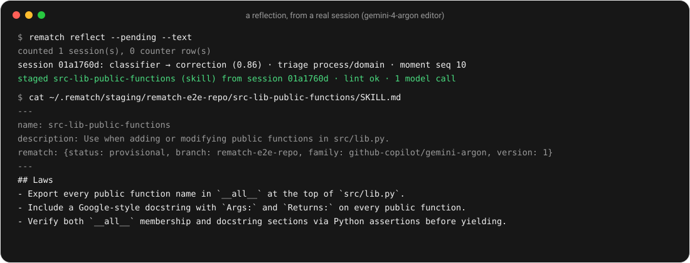

# Your first session

After installing, seed the ledger from the sessions you already have, then work as usual. The first proposal arrives after the first session that ends with a redirect.

## Seed from history

```
rematch import --history [--harness omp|claude-code|codex|all] [--skip-profile <name>…]   # omp (default + profiles), Claude Code (~/.claude/projects) and Codex (~/.codex/sessions) history → the ledger (no model)
rematch reflect --history [--since 2026-10-01] [--limit 10]
```
`reflect --history` treats every imported session that the extension would have flagged (a redirect, or a tool-error cluster) like a fresh one: it rebuilds the session's trace from omp's file, then runs the normal reflection (same rate limits, ≤ 3 model calls each). Newest first, at most `--limit` sessions per run (default 10); run it again for the next batch. A session is reflected once; the envelope lists each session's outcome.

## The loop, in one minute

1. **Work.** You ask for a function in `src/lib.py`. The agent adds it. You answer: *"That's wrong. Every public function here needs a Google-style docstring and must be exported in `__all__`."* The extension pre-labels the turn as a negation and flags the session at shutdown.
2. **Reflect.** Next session start, the binary classifies the redirect (`correction`, 0.86), triages it as a process failure about this workload's conventions, and runs the domain editor once with the trace excerpt. The reply passes lint and is staged with a predicate: this repo, `.py` files, the stems of the task turn.
3. **Keep or retire.** The next session that adds a function to `src/lib.py` loads the entry. In the scratch run behind the screenshots below the agent exported and documented the function unprompted; that is one session on a toy repository, not a measured gain. The session counts as `matched 1 · recurrence 0 · harm 0`. Three more like it and the entry is `kept`; two redirects of the same class and it is retired.

<p align="center">
  <picture>
    <source media="(prefers-color-scheme: dark)" srcset="../assets/reflect-dark.svg">
    
  </picture>
</p>
<p align="center"><em>A reflection from a real session on a scratch repository, with gemini-4-argon as classifier and editor. Output condensed to the lines that matter.</em></p>

<p align="center">
  <picture>
    <source media="(prefers-color-scheme: dark)" srcset="../assets/why-dark.svg">
    
  </picture>
</p>
<p align="center"><em>The next matched session. <code>why</code> explains the load and the count; <code>ls</code> shows the counts raw.</em></p>

What each line means: [What you'll see](what-you-see.md). The steps behind the reflection: [The loop](../concepts/loop.md).

---

Source: README.md ("Thirty-second start", "In one minute"); moved from docs/MANUAL.md ("Learning from sessions before rematch was installed"); docs/DESIGN.md §2 (`reflect --history`).
