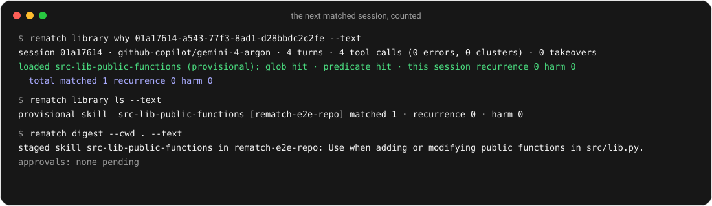

# What you'll see

## At session start

In omp, when a reflection staged something, one line at the top of the session:

```
staged skill src-lib-public-functions in my-repo: Use when adding or modifying public functions in src/lib.py.
```

At each session start the omp extension spawns `rematch reflect --pending` detached, then shows the digest (≤5 lines, then `+N more`) and one confirm per approval → `library approve|decline <id>`. `alt+e` shows the digest on demand.

In Claude Code the same digest arrives as a message at session start, with the approval commands (there is no dialog):

```
rematch digest
- staged skill run-tests-before-commit in payments: Use when …
- 1 approval(s) pending
Waiting for your approval (Claude Code has no approval dialog; run one of these yourself, or `rematch library approve|decline <id>` in a shell):
- hook stuck-detector: /rematch:rematch-approve <id> · /rematch:rematch-decline <id>
```

## Asking it

| Ask | What you get |
|---|---|
| `/rematch status` | counts of entries by status, pending flags, whether it is off |
| `/rematch why` | for the last session: which entries were loaded, whether the predicate hit, the redirects it saw and how they were classified, the running counters |
| `/rematch library` | every entry with its raw counts: `provisional skill foo [repo] matched 2 · recurrence 0 · harm 0` |
| `/rematch digest` | what was staged, kept or retired since you last looked, plus anything waiting for approval |
| `rematch doctor --text` | omp version, resolved model roles, plugin linked, ledger state |

`why` is the one to read when something surprises you: it shows exactly why an entry was or was not loaded (`glob hit · predicate miss`) and what the classifier called your redirect.

## Checking the install

`rematch doctor` checks every harness and service and ends with `ready: true|false`. One line per harness, then roles, ledger, paths, every problem, and the verdict:

```
omp: ok · /…/omp (omp/18.12.6) · extension @vncp/rematch linked → /…/rematch/extension, loads ./index.ts
claude-code: ok · ~/.claude/skills/rematch → /…/adapters/claude-code · skills/ → shared dir · claude plugin validate passed
codex: ok · ~/.agents/skills/rematch → shared dir
profile: ok · origin git@…/profile.git · 0 ahead, 0 behind (last fetch) · launchd loaded
lake: ok · lag 0 journal row(s) · index pinned 0.1.0 · bellwether 0.1.0 (/…/bellwether)
built-ins: ok · context-unit-retrieval provisional, awaiting approval · tool-output-truncation … · stuck-detector …
role rematch-editor: … (via …)
…
ledger: …/ledger.sqlite (schema 2)
agent_dir: …
root: … · N sessions (N traced) · N pending · off: false
ready: true
```

- A harness that is not set up says so (`claude-code: not set up (~/.claude/skills/rematch absent)`, `codex: not set up (… ; ln -s ~/.rematch/skills ~/.agents/skills/rematch)`, `profile: not set up (rematch profile init …)`, `lake: not set up (…)`) and is never a problem. One that is set up and broken is: a dangling plugin link, a plugin whose `skills/` does not reach `REMATCH_ROOT/skills`, `claude plugin validate` failing, a Codex link pointing elsewhere, profile conflicts, a launchd plist written but not loaded, a lake index pinned to another Bellwether, a built-in never installed, an extension listed in omp's lock but not loadable.
- With problems the last line is `ready: false (N problem(s))`, each preceded by a `problem: …` line saying what to run.
- `claude plugin validate` runs when `claude` is on PATH (`$CLAUDE_BIN` overrides); otherwise static checks only, and the line says so. launchd is checked with `launchctl list com.vncp.rematch.profile-sync` once the plist exists (`$LAUNCHCTL_BIN` overrides).
- JSON: `ready`, `problems`, `harnesses.{omp, claude-code, codex, profile, lake, built-ins}` each with `status: ok | not set up | problem` and its `problems`.

## The next matched session

<p align="center">
  <picture>
    <source media="(prefers-color-scheme: dark)" srcset="../assets/why-dark.svg">
    
  </picture>
</p>
<p align="center"><em>The next matched session. <code>why</code> explains the load and the count; <code>ls</code> shows the counts raw.</em></p>

---

Source: moved from docs/MANUAL.md ("Day to day", "Reading what it tells you"); extension/README.md ("Session start"); adapters/claude-code/README.md ("Digest"); README.md ("In one minute"); docs/DESIGN.md §2 (`doctor`).
