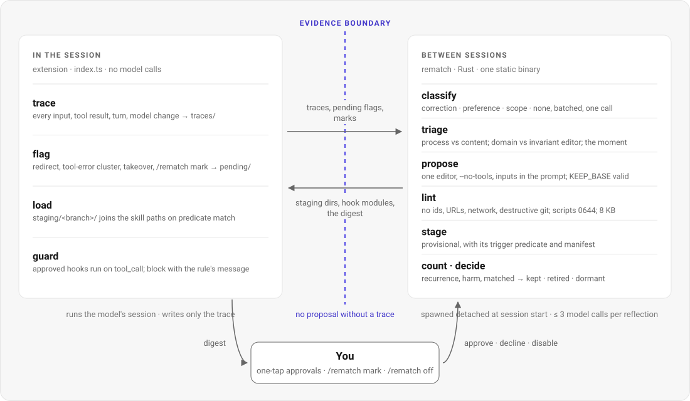

  <picture>
    <source media="(prefers-color-scheme: dark)" srcset="assets/wordmark-dark.svg">
    
  </picture>

<b>Let the agent improve its own harness from the sessions you were going to run anyway, and keep only what later sessions confirm.</b>

## What you can do with it

- **Do nothing.** Work in omp as usual. Every session is traced. A session that ended with a redirect, a tool-error cluster, or a takeover produces one bounded proposal at the start of the next session, staged as `provisional`. Later sessions that match load it. Counters decide whether it stays.
- **Create a skill.** `/rematch create <name> --from sessions|task`. From three matching sessions, or from one reference run of a task you name. A description with neither becomes a `draft` that never loads until you activate it.
- **Improve a skill from history.** `/rematch improve <skill>`. Registers it, audits where it loaded, clusters the redirects and errors that happened with it in context, proposes unit-level edits, stages the new version beside the old one. Refuses with a count if fewer than five traced sessions used it, and offers the mechanical split instead.
- **Run a batch job with a verifier.** `/rematch run --task <id> --verifier <cmd>`. Reference rollout, two candidates, probe, compose, re-run; the verifier picks. Never a model's opinion of its own output.
- **See why.** `/rematch why`, `/rematch status`, `/rematch library`. Which entries were loaded for the last deliverable, what was staged, kept, retired, and the raw counts per entry.
- **Correct it or stop it.** `/rematch mark correction|preference|scope` overrides the classifier for the last turn. `/rematch off`, `REMATCH=0`, `/rematch disable <id>`, `/rematch rollback <skill>`, `rematch uninstall` are immediate.

## How it works

Every claim below carries the id of the decision it rests on; the evidence and the paper behind each id are in [`docs/research.md`](research/provenance.md) §2.

The session is the evidence. The extension writes every input, tool result and turn to a trace file of its own, and at shutdown flags the session only if it carried a signal: a redirect, a cluster of tool errors, a takeover, or an explicit mark. No proposal exists without that trace (D1). Nothing runs inside the session. At the start of the next session the binary is spawned detached: it classifies the redirect, finds the moment, runs one editor scoped by triage to how the agent works or to what a practitioner knows (D5), lints the result for generalization (D15), and stages it as a `provisional` entry with a deterministic trigger predicate (D12) and a manifest naming the predicted fix and the predicted regression (D16). Sessions whose predicate matches load it from the staging path; there is no withheld arm (D11). For each matched session the binary counts whether the specific redirect class that motivated the entry recurred, and whether harm occurred (D10). Keep at zero recurrences over at least four matched sessions; retire at two recurrences or two harm events; dormant after twelve without a decision (D8, D13). Only failures are reflected on; the system never grades its own successes (D9).

---

<b>A harness-improvement loop that costs no reruns in interactive use. The real session is the reference rollout, the next matched session is the probe, and a reflection costs at most three model calls.</b>

rematch is an omp plugin: a TypeScript extension that omp loads, and a Rust binary the extension calls with a JSON envelope. The extension only records and toggles; the binary proposes and stages. The boundary between what a model may propose and what the system may write is enforced by record types, not by a prompt: proposals carry no score field, and nothing activates without a lint report and, for anything executable, a receipt (D24). Skill text activates in personal scope on its own. Anything executable (scripts, hooks) and anything beyond personal scope (team `.omp/`, your fork) waits for a one-tap approval or a merged PR (D4, D3). No fork of omp is required; the fork is one of the things it can propose changes to.

The loop design, the scoped editors, the preference for skills and scripts over prose, and the experience library come from Harness² (Xu et al., arXiv 2610.14224); the `improver/` prompts are derived from its Appendix H, with every delta listed in [`docs/research.md`](research/provenance.md) §5. Compiled hooks for recurring corrections come from Trace (D4); the counters and caps from ACE, Evo-Harness and HCL (D13, D14); the trust boundary from bellwether (D24).

  <picture>
    <source media="(prefers-color-scheme: dark)" srcset="assets/loop-dark.svg">
    
  </picture>

## How it compares

| | Hand-written skills | compound-forge (SkillOpt / GEPA) | rematch |
|---|---|---|---|
| Where evidence comes from | your memory of what went wrong | a benchmark suite you maintain | the execution trace of the session that went wrong |
| Cost per improvement | your time | dozens to hundreds of rollouts | ≤ 3 model calls, 0 reruns (interactive); 4–10 rollouts with a verifier (batch) |
| What decides | you | validation score on held-out cases | recurrence of the motivating redirect over later matched sessions; a verifier in batch mode |
| What can activate on its own | everything you write | nothing (proposals are reviewed) | skill text in personal scope; never scripts, hooks, team or fork changes |
| Exit for a bad change | you notice | regression on the suite | counters retire it; rollback restores the predecessor; `off` stops everything |

**In short:** the loop (scoped editors, lint for generalization, an experience library, composition only where a verifier exists) comes from Harness²; the prompts are derived from its Appendix H, not verbatim (D5, D6; deltas in `docs/research.md` §5). What rematch adds is the zero-rerun interactive mode with a deterministic predicate and raw counters (D10, D12), and a boundary that lets the harness propose without being trusted (D24). The cost: a single user is not blinded, so the counters measure only the recurrence of a specific redirect class, something you would not fake; and nothing is ever called verified.

## Where to go next

- [Install](get-started/install.md) for omp, Claude Code or Codex, then [your first session](get-started/first-session.md).
- [Concepts](concepts/loop.md): the loop, the evidence boundary, entries and statuses, predicates and domains, counters and the kill criterion, the profile, the lake.
- [Guides](guides/day-to-day.md): day-to-day use, correcting the classifier, approvals, creating and improving skills, batch mode, sharing, syncing machines, the report, the lake.
- [Reference](reference/cli.md): every subcommand's `--help`, the trace schema, the entry layout, lint rules, configuration, environment variables, file locations.
- [Research](research/decisions.md) and [Design](design/architecture.md): the decisions with their evidence, the implementation contract, ADR 001.
- [Status and limits](status.md): what is built, what was run live, what has not been earned yet.

---

Source: README.md (tagline, "What you can do with it", "How it works", "How it compares").
